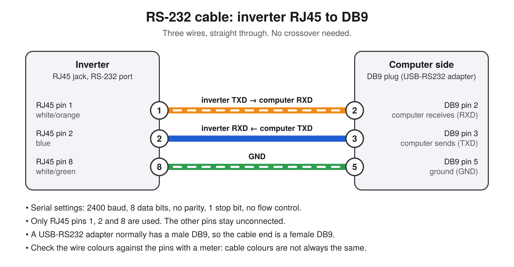

# Xunzel IXS-ON 7200: read-only RS-232 monitoring

Read live values, settings and warnings from a **Xunzel IXS-ON 7200 W** solar inverter over its RS-232 port, using one small Python script with a menu. No packages to install.

It was built and tested on the **Xunzel PACK ZERO+ AX 490 L** solar kit (bought at Leroy Merlin in Portugal), and it only ever **reads**.


*The wiring leaflet that comes with the kit (our photo, straightened and cleaned up). Leaflet artwork © Xunzel, shown only to identify the kit.*

---

## Read-only by design (and why)

> **This project never changes anything in the inverter. It only sends read commands.**

Why we are strict about it:

- **The kit is plug and play.** The PACK ZERO+ is sold as a matched set: lithium batteries, inverter, solar panels and PV protection. Xunzel pre-configured the inverter for it. Nothing needs to be set up.
- **The settings are not ours to touch.** The inverter's battery voltages, charge limits and battery type were chosen for the batteries in the kit. They differ from generic factory defaults (see [what we found](#what-we-found-on-this-inverter)). A wrong value can hurt the batteries.
- **Warranty.** Changing settings, or resetting the inverter, could make a warranty claim harder. We do not know exactly what Xunzel's warranty allows over RS-232, and we do not want to find out the hard way. So the rule is simple: look, never touch. Monitoring software normally works the same way, with read queries.
- **If you want to change a setting,** do it on the inverter itself, following Xunzel's instructions.

The rule is enforced in code, not just by good intentions: see [How read-only is enforced](#how-read-only-is-enforced).

**Not affiliated with Xunzel.** Names and logos belong to their owners. This is an independent hobby project. It is provided as is, under the MIT licence, with no warranty. You are responsible for your own equipment and for checking your own warranty terms.

---

## What you need

- A computer with **Python 3** (macOS or Linux; no extra packages).
- A **USB-to-RS-232 adapter** with a DB9 plug (we used one with an FTDI FT232R chip, which macOS recognises without a driver).
- A cable from the inverter's **RJ45 RS-232 port** to the DB9 plug. See the wiring below.

## Wiring



| Inverter RJ45 pin | Typical wire colour | DB9 pin | Signal |
|---|---|---|---|
| 1 | white/orange | 2 | inverter TXD to computer RXD |
| 2 | blue | 3 | inverter RXD from computer TXD |
| 8 | white/green | 5 | ground |

Settings: **2400 baud, 8 data bits, no parity, 1 stop bit, no flow control.**

The pinout comes from the generic Voltronic protocol document for this inverter family. Wire colours differ between cables, so check them with a meter. The drawing is ours; the SVG source is in `docs/images/`.

**Test the adapter first, without the inverter.** Short DB9 pins 2 and 3 together and run `screen /dev/cu.usbserial-XXXX 2400` (on Linux, `/dev/ttyUSB0`). Letters you type should appear on screen. Remove the short and they should stop. Quit with Ctrl-A, then K, then Y. Never type into the terminal while the inverter is connected.

## Quick start

```bash
git clone https://github.com/Terramadas/Xunzel-RS232-Protocol.git
cd Xunzel-RS232-Protocol
python3 xunzel_readonly.py
```

You get a menu. Pick a number:

```
==== Xunzel IXS-ON 7200: READ-ONLY tool ====
  1  Quick status (mode, live values, warnings, flags)
  2  Live values once (QPIGS)
  3  Ratings and current settings (QPIRI)
  4  Setting flags (QFLAG)
  5  Warnings and faults (QPIWS)
  6  Serial number and firmware (QID, QVFW, QVFW2)
  7  Default settings (QDI, read only)
  8  Every read-only command in the manual
  9  Watch live values repeatedly (Ctrl-C to stop)
 10  Log live values to a CSV file (Ctrl-C to stop)
 11  Self-test (CRC + safety checks, no inverter needed)
 12  List the allowed commands
  p  Choose serial port / baud rate
  0  Quit
```

The script finds the USB serial port by itself (`/dev/cu.usbserial*` on macOS, `/dev/ttyUSB*` on Linux). Use `p` to pick another one. On Linux you may need to add your user to the `dialout` group.

You can also skip the menu: `python3 xunzel_readonly.py QPIGS`, `python3 xunzel_readonly.py --list`, `python3 xunzel_readonly.py --selftest`. Everything is also written to `xunzel_readonly.log` in the current folder, which is ignored by git because it contains your inverter's serial number.

A real example of the output is in [`examples/sample-output.txt`](examples/sample-output.txt). The first lines of a live-values reading look like this:

```
> QPIGS  (reply in 0.49 s)
  CRC : OK
   3  AC output voltage                                          230.0     V
   6  AC output active power                                     0081      W
   9  Battery voltage                                            54.10     V
  11  Battery capacity                                           099       %
  14  PV input voltage 1                                         273.1     V
  20  PV charging power [not in this manual]                     00073     W
```

## What you can read

| Command | What it gives you |
|---|---|
| `QPIGS` | Live values: grid and output voltage, load, battery voltage and charge, PV voltage and power, status bits |
| `QMOD` | Operating mode (battery, line, standby, fault, ...) |
| `QPIWS` | Warning and fault bits |
| `QPIRI` | Ratings and current settings |
| `QFLAG` | Which options are switched on or off |
| `QDI` | The default settings (this only reads them; it does not apply them) |
| `QID`, `QVFW` | Serial number, firmware version |

Full details, byte-by-byte frames and field tables are in **[docs/PROTOCOL.md](docs/PROTOCOL.md)**.

## How read-only is enforced

1. **Whitelist, not blacklist.** The script can only build frames for the fixed list of query commands. Anything else is refused before the serial port is opened. Every allowed command starts with `Q`.
2. **One place writes to the port,** and it checks the whitelist itself. There is no option to switch this off.
3. **No typing into the menu.** You pick numbers; you never enter a command.
4. **Self-test.** `--selftest` checks the CRC against known values and real replies, and checks that setting commands (and typos of query commands) are refused.
5. **Reply checking.** Only replies with the right shape and a matching CRC are accepted.

If you write your own logger, the same rules apply. See [docs/PROTOCOL.md](docs/PROTOCOL.md#writing-your-own-logger-safely).

## What we found on this inverter

The Xunzel talks the common Voltronic/Axpert "PI30" protocol, but not exactly the way the generic 2014 protocol document describes:

- **Works:** `QMOD`, `QPIGS`, `QPIWS`, `QFLAG`, `QPIRI`, `QDI`, `QID`, `QVFW`.
- **Answers NAK (not supported):** `QPI` and `QVFW2`. Do not rely on `QPI` to detect the protocol.
- **More fields than documented:** `QPIGS` returns 21 fields (the document describes 17), `QPIRI` 28 (document: 25), `QDI` 26 (document: 25), and `QPIWS` 36 characters (document: 32). The extra fields are listed in the protocol document, with their likely meaning marked as unconfirmed.
- **Reply times:** 0.05 to 0.5 seconds. Polling `QPIGS` every 10 seconds is comfortable.
- **Pre-configured for the batteries:** the battery voltages and charge settings in the inverter differ from the factory defaults that `QDI` reports, as you would expect if the installer set them up for the lithium batteries. The inverter also reports battery type code 8, which the generic document does not describe.
- **Off-grid:** with no grid connected, `QPIWS` always reports `LINE_FAIL`. That is normal.
- **PV voltage matches the leaflet:** the PV input voltage reads about 270 to 280 V in daylight, which fits seven 425 W panels per string as drawn in the leaflet (Voc about 295 V).

## Ideas for later

- A small always-on logger (Arduino Ethernet or Raspberry Pi with a MAX3232 level shifter) that stores `QPIGS` readings and serves them to a NAS or Home Assistant. The CSV format of `--csv` is the planned log format.
- The kit has two PV inputs (PV1 and PV2). Newer Voltronic documents describe a command for the second one; it is not in the document we used, so we have not tried it.

Reports from other Xunzel or Voltronic-family inverters are welcome. If you share output, please remove your serial number first.

## Files

| Path | Purpose |
|---|---|
| `xunzel_readonly.py` | The read-only tool with menu |
| `docs/PROTOCOL.md` | Protocol reference: frames, CRC, commands, field tables |
| `docs/images/` | Wiring leaflet, cable drawing (PNG and SVG) |
| `examples/sample-output.txt` | Real output, serial number removed |

## Licence

MIT, see [LICENSE](LICENSE).
